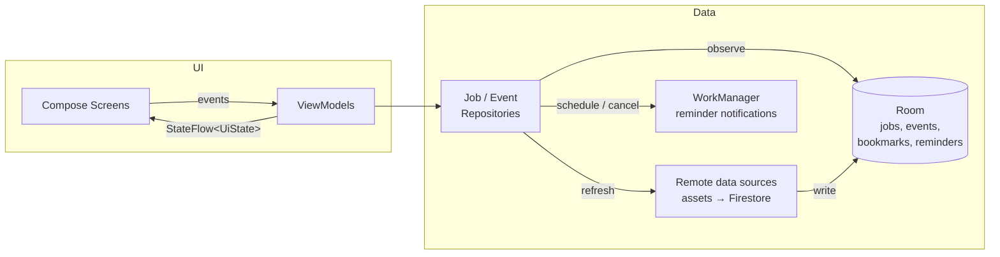

# PuskarUIN

**PuskarUIN** is an Android app that helps UIN Syarif Hidayatullah Jakarta students find internships, job openings, and career events from the campus Career Center (Pusat Karier), all in one place.

I built it while interning as a Data Specialist at Pusat Karier UIN Jakarta. Right now openings are spread across posters, Instagram posts, and group chats, so students miss deadlines. This app puts them in one searchable place that works offline and reminds students before events start.

> 🚧 **Status: early development (v0.2.0).** The app currently uses bundled **sample data** (companies and organizers marked "contoh"). Real data from Firestore is the next milestone; see the [Roadmap](#roadmap).

## Screenshots

| Jobs | Job detail | Search |
|---|---|---|
|  |  |  |

| Events | Event detail | Saved | Dark theme |
|---|---|---|---|
|  |  |  |  |

*Screenshots are generated automatically by the UI test suite ([Roborazzi](https://github.com/takahirom/roborazzi)), so they always match the current code.*

## Features

- 📋 **Job and internship list** sorted by the closest deadline, with a "N days left" countdown
- 🔍 **Search** by position, company, or location
- 🏷️ **Filter** by type (Internship / Full-time / Part-time)
- 🔖 **Bookmarks** that are saved on the device and survive data refreshes
- 📅 **Career events** (job fairs, workshops, webinars, company visits), split into upcoming and past, with an online/offline filter
- 🔔 **Event reminders:** a notification 1 hour before the event starts; tapping it opens the event
- 🗓️ **Add to calendar** and **share** for events and jobs
- ⭐ **Saved tab** with bookmarked jobs and active reminders in one place
- 📴 **Offline-first:** the last loaded data stays available without a connection
- ↻ **Pull to refresh**, with an error message if loading fails
- 🌙 Light and dark theme (Material 3)

## Tech stack

| Layer | Technology |
|---|---|
| Language | Kotlin |
| UI | Jetpack Compose, Material 3, type-safe Navigation Compose |
| Architecture | MVVM, unidirectional data flow, repository pattern |
| Async | Kotlin Coroutines and Flow |
| Local storage | Room (with auto-migrations) |
| Background work | WorkManager (event reminders) |
| Dependency injection | Hilt |
| Serialization | kotlinx.serialization |
| Testing | JUnit, Turbine, kotlinx-coroutines-test, Robolectric, Compose UI Test, Roborazzi |
| CI | GitHub Actions (build, unit tests, lint, APK artifact) |

## Architecture



- **Room is the single source of truth.** The UI only observes the database, and refreshing from the remote source just updates it. That is why the app keeps working offline.
- **Bookmarks and reminders have their own tables**, so replacing the data on refresh never deletes what the user saved.
- **Reminders use WorkManager**, so they survive app restarts and reboots without the exact-alarm permission. Event times are always treated as WIB, even when the phone is set to another time zone.
- **Time is injected** (`java.time.Clock`), so "upcoming vs past" and reminder timing are tested with a frozen clock.
- **Database changes ship with migrations.** Room's `AutoMigration` upgrades v1 to v2 without losing bookmarks.
- **The remote data sources are interfaces.** Today they read `assets/jobs.json` and `assets/events.json`. Switching to Firestore means writing one new class and changing one Hilt binding, with no changes to the UI or the repository.
- **Screens are stateless.** Each `*Route` connects a ViewModel to a stateless `*Screen`, so screens can be previewed and tested without Hilt.

```
app/src/main/java/com/azvar/puskar/
├── core/designsystem/   # Theme and colors
├── data/
│   ├── local/           # Room entities, DAOs, database
│   ├── reminder/        # WorkManager scheduler + notification worker
│   ├── remote/          # Remote data sources + DTOs
│   └── repository/      # Offline-first repositories
├── di/                  # Hilt modules
├── domain/model/        # Plain Kotlin models + filter logic
└── ui/
    ├── components/      # Reusable composables, formatters, intents
    ├── events/          # Event list + detail screens and ViewModels
    ├── jobs/            # Job list screen + ViewModel
    ├── jobdetail/       # Job detail screen + ViewModel
    ├── saved/           # Saved tab
    └── navigation/      # Bottom navigation + type-safe NavHost
```

## Testing

```bash
./gradlew testDebugUnitTest        # all unit and UI tests (runs on the JVM, no emulator needed)
./gradlew recordRoborazziDebug     # regenerate the screenshots in docs/screenshots
```

- `JobFilterTest` covers the pure search and filter logic.
- `JobsViewModelTest` and `EventsViewModelTest` cover UI state, filters, bookmarks, reminders, and failed refreshes, using fake repositories and a frozen clock.
- `OfflineFirstEventRepositoryTest` runs the **real Room queries** on an in-memory database: ordering, reminders surviving a refresh, and keeping cached data when the network fails.
- `ReminderDelayTest` checks reminder timing, including a phone set to a different time zone.
- `AppFlowTest` runs the **real app** (Hilt, Room, WorkManager, and the bundled data) through Robolectric: browsing, search, bookmarking, and turning on a reminder.
- `DarkModeScreenshotTest` captures the dark theme.

## Getting started

1. Clone the repository and open it in a recent version of **Android Studio**.
2. Wait for Gradle sync to finish. Android Studio will offer to download any missing SDK.
3. Run the `app` configuration on an emulator or a device (Android 8.0 / API 26 or newer).

No API keys or extra setup are needed for now.

## Roadmap

- [x] Project setup: Compose, Hilt, Room, Navigation, CI
- [x] Job list with search, filter, bookmarks, and offline cache
- [x] Job detail screen
- [x] Unit tests, Robolectric UI tests, automatic screenshots
- [x] **Career events** tab with reminders, calendar, and share
- [x] Saved tab, bottom navigation, dark theme
- [ ] Load real data from **Cloud Firestore**, managed by Career Center staff
- [ ] Push notifications for new openings (**Firebase Cloud Messaging**)
- [ ] ✨ **AI CV review and job matching** with **Gemini** (Firebase AI Logic)
- [ ] Sign in with a Google account (**Firebase Auth**)
- [ ] Release on Google Play (closed testing)

## Author

**Muhamad Azvar Al Hasan**, Information Systems student at UIN Syarif Hidayatullah Jakarta.

## License

[MIT](LICENSE)
