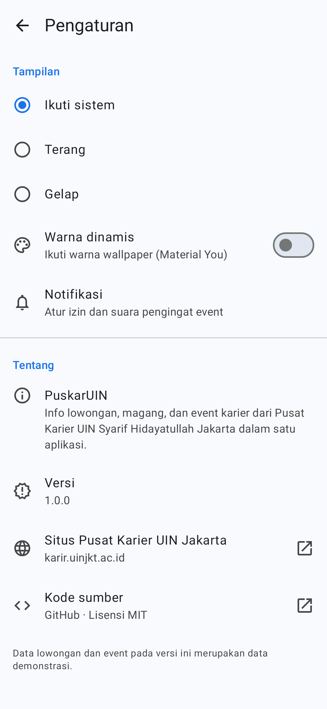
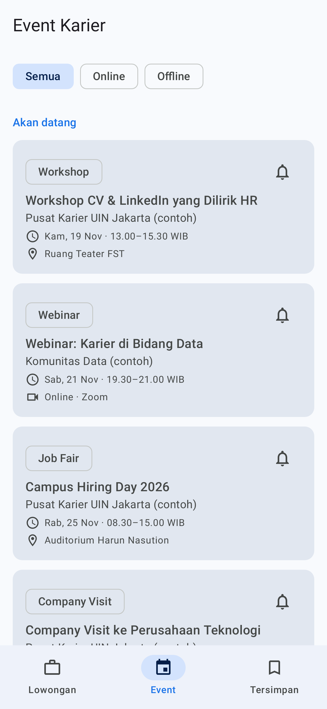
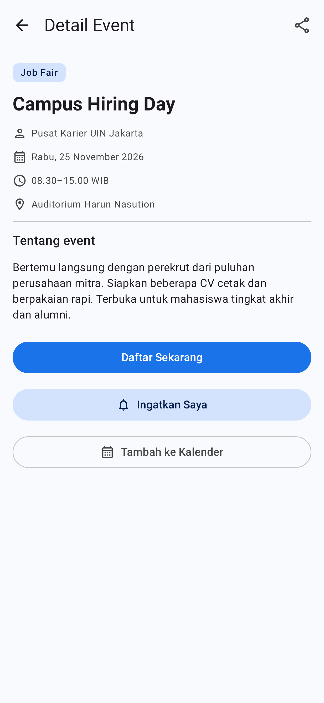
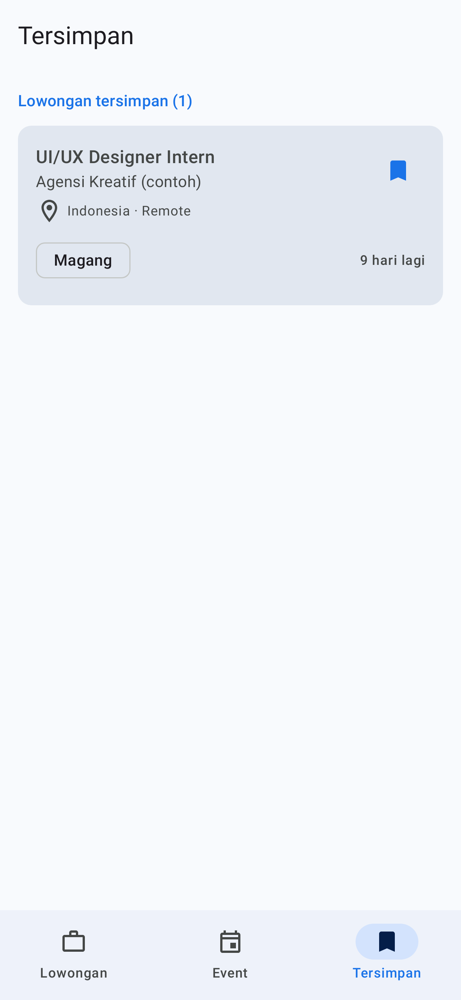
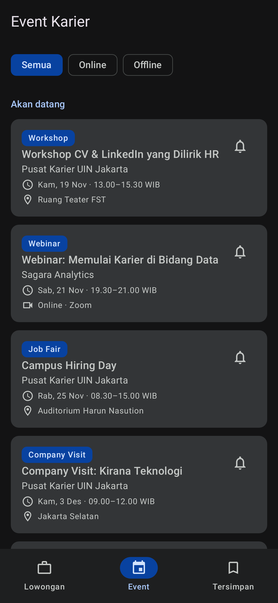
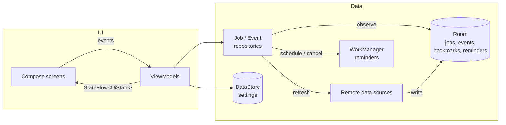

<h1 align="center">PuskarUIN</h1>

<p align="center">
  Internships, jobs, and career events from <b>Pusat Karier UIN Syarif Hidayatullah Jakarta</b>, in one Android app.
</p>

<p align="center">
  <a href="https://github.com/Azvar-AlHasan/PuskarUIN/actions/workflows/android.yml"></a>
  <a href="https://github.com/Azvar-AlHasan/PuskarUIN/releases/latest"></a>
  
  
  <a href="LICENSE"></a>
</p>

Career opportunities for UIN Jakarta students are usually shared across posters, Instagram posts, and group chats, so deadlines are easy to miss. **PuskarUIN** collects them in one place. Students can search and filter openings, save the ones they like, and get a reminder before a career event starts. It all works offline.

## Download

Get the latest APK from **[Releases](https://github.com/Azvar-AlHasan/PuskarUIN/releases/latest)**. It runs on Android 8.0 (API 26) or newer.

## Screenshots

| Jobs | Job detail | Search | Settings |
|---|---|---|---|
|  |  |  |  |

| Events | Event detail | Saved | Dark theme |
|---|---|---|---|
|  |  |  |  |

<sub>The UI test suite generates these screenshots (<a href="https://github.com/takahirom/roborazzi">Roborazzi</a>), so they always match the code.</sub>

## Features

**Jobs and internships**
- Search by position, company, location, or industry, and filter by Internship / Full-time / Part-time
- Sort by closest deadline or newest; closed openings move to the bottom
- Detail page with key facts, qualifications, benefits, compensation, and a company profile
- "N days left" countdown, highlighted when a deadline is less than a week away
- Bookmarks are stored on the device and kept when the data refreshes

**Career events**
- Job fairs, workshops, webinars, and company visits, split into *upcoming* and *past*, with an online/offline filter
- **Reminders:** a notification one hour before the event; tapping it opens the event
- One tap to **add to calendar** or **share**

**App**
- *Saved* tab with bookmarked jobs and active reminders
- Light, dark, or system theme, plus Material You dynamic color on Android 12+
- Offline-first: the last loaded data is always available
- Splash screen, skeleton loading, and helpful empty states
- Screen reader friendly: semantic headings, labeled icon buttons, and static labels that aren't announced as buttons

## Tech stack

| Area | Technology |
|---|---|
| Language | Kotlin |
| UI | Jetpack Compose, Material 3, type-safe Navigation Compose, SplashScreen API |
| Architecture | MVVM, unidirectional data flow, offline-first repositories |
| Async | Coroutines and Flow |
| Persistence | Room (with auto-migrations), DataStore |
| Background work | WorkManager |
| Dependency injection | Hilt |
| Serialization | kotlinx.serialization |
| Testing | JUnit, Turbine, coroutines-test, Robolectric, Compose UI Test, Roborazzi |
| CI | GitHub Actions: build, unit and UI tests, lint, APK artifacts |

## Architecture



- **Room is the single source of truth.** Screens only observe the database, and a refresh just updates it. This is what keeps the app working offline.
- **User state lives in its own tables.** Bookmarks and reminders are separate from the content tables, so a refresh never removes them.
- **Time is injected** (`java.time.Clock`). Logic like "upcoming vs. past", "closed", and reminder timing is tested with a frozen clock. Event times are always in WIB, even when the phone uses another time zone.
- **Schema changes ship with migrations.** Room `AutoMigration` takes v1 → v2 → v3 without losing user data.
- **The data source can be swapped.** `JobRemoteDataSource` and `EventRemoteDataSource` are interfaces. To connect a backend (Firestore, a REST API, …), write one class per interface and change one Hilt binding. The repositories and UI stay the same.
- **Screens are stateless.** Each `*Route` connects a ViewModel to a stateless `*Screen`, which can be previewed and tested without Hilt.

```
app/src/main/java/com/azvar/puskar/
├── core/designsystem/   # Theme and color schemes
├── data/
│   ├── local/           # Room entities, DAOs, database
│   ├── reminder/        # WorkManager scheduler + notification worker
│   ├── remote/          # Data source interfaces, DTOs, bundled dataset
│   ├── repository/      # Offline-first repositories
│   └── settings/        # DataStore-backed user settings
├── di/                  # Hilt modules
├── domain/model/        # Plain Kotlin models, filtering and sorting
└── ui/
    ├── components/      # Shared composables, formatters, intents
    ├── events/          # Event list and detail
    ├── jobs/            # Job list
    ├── jobdetail/       # Job detail
    ├── saved/           # Saved tab
    ├── settings/        # Settings and about
    └── navigation/      # Bottom navigation + type-safe NavHost
```

## Data

The app includes a sample dataset of 16 openings and 8 events in `app/src/main/assets`. The organizations in it are fictional. Its dates are stored relative to the current day, so it always contains open, closing-soon, and closed items. Apply and registration buttons open the official Pusat Karier site, [karir.uinjkt.ac.id](https://karir.uinjkt.ac.id).

## Testing

```bash
./gradlew testDebugUnitTest      # unit + UI tests on the JVM (no emulator needed)
./gradlew lintDebug              # Android lint
./gradlew recordRoborazziDebug   # regenerate docs/screenshots
```

| Test | What it covers |
|---|---|
| `JobFilterTest` | Search, type filter, sorting, and closed openings sinking to the bottom |
| `JobsViewModelTest`, `EventsViewModelTest` | UI state, filters, sorting, bookmarks, reminders, and failed refreshes (fake repositories, frozen clock) |
| `OfflineFirstEventRepositoryTest` | Real Room queries on an in-memory database: ordering, reminders surviving refreshes, offline fallback |
| `ReminderDelayTest` | Reminder timing, including a phone set to another time zone |
| `AppFlowTest` | The real app (Hilt, Room, WorkManager) through Robolectric: browse, search, bookmark, enable a reminder, open settings |
| `DarkModeScreenshotTest` | Dark theme rendering |

## Building from source

1. Clone the repository and open it in a recent version of **Android Studio**.
2. Let Gradle sync. Android Studio offers to download any missing SDK.
3. Run the `app` configuration on an emulator or device.

No API keys are required.

## Roadmap

- Connect a live backend (Cloud Firestore) that Career Center staff can manage
- Push notifications for new openings (Firebase Cloud Messaging)
- AI-assisted CV review and job matching with Gemini
- Sign in with a Google account

## Author

**Muhamad Azvar Al Hasan**, Information Systems, UIN Syarif Hidayatullah Jakarta

## License

Released under the [MIT License](LICENSE).
