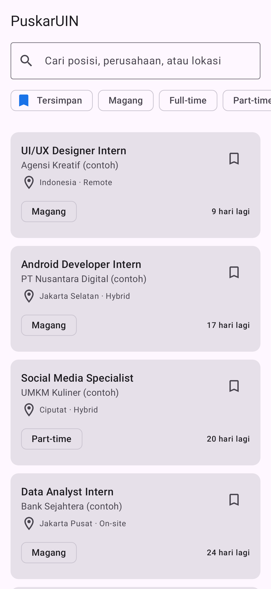
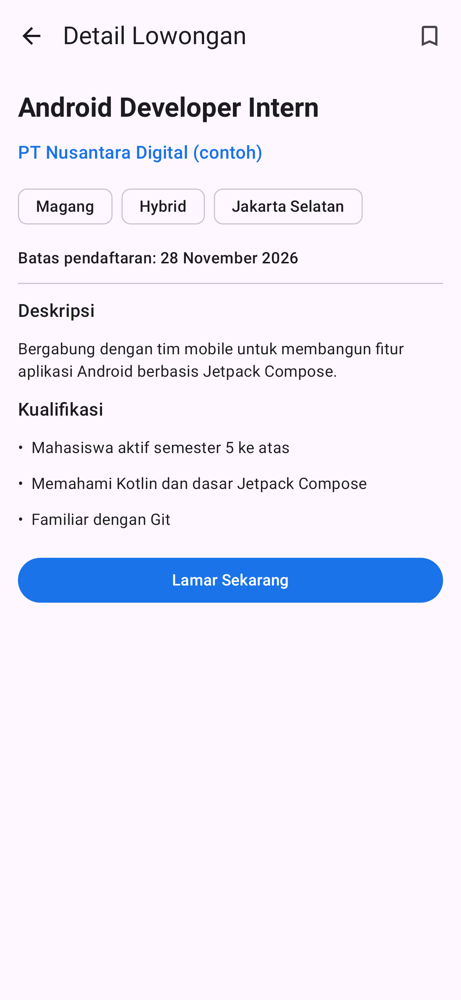
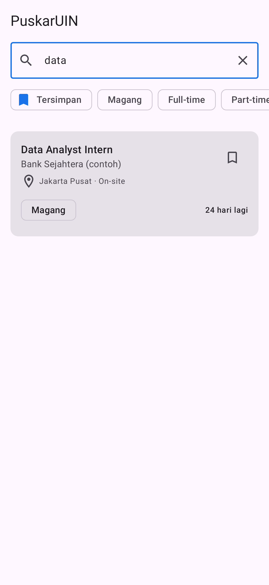
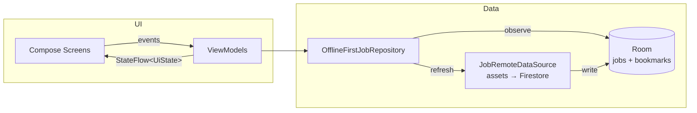

# PuskarUIN

**PuskarUIN** is an Android app that helps UIN Syarif Hidayatullah Jakarta students find internships and job openings shared by the campus Career Center (Pusat Karier), all in one place.

I built it while interning as a Data Specialist at Pusat Karier UIN Jakarta. Right now openings are spread across posters, Instagram posts, and group chats, so students miss deadlines. This app puts them in one searchable list that still works offline.

> 🚧 **Status: early development (v0.1.0).** The app currently uses bundled **sample data** (companies marked "contoh"). Real data from Firestore is the next milestone; see the [Roadmap](#roadmap).

## Screenshots

| Job list | Job detail | Search |
|---|---|---|
|  |  |  |

*Screenshots are generated automatically by the UI test suite ([Roborazzi](https://github.com/takahirom/roborazzi)), so they always match the current code.*

## Features

- 📋 **Job and internship list** sorted by the closest deadline, with a "N days left" countdown
- 🔍 **Search** by position, company, or location
- 🏷️ **Filter** by type (Internship / Full-time / Part-time)
- 🔖 **Bookmarks** that are saved on the device and survive data refreshes
- 📴 **Offline-first:** the last loaded list stays available without a connection
- ↻ **Pull to refresh**, with an error message if loading fails
- 🌙 Light and dark theme (Material 3)

## Tech stack

| Layer | Technology |
|---|---|
| Language | Kotlin |
| UI | Jetpack Compose, Material 3, type-safe Navigation Compose |
| Architecture | MVVM, unidirectional data flow, repository pattern |
| Async | Kotlin Coroutines and Flow |
| Local storage | Room |
| Dependency injection | Hilt |
| Serialization | kotlinx.serialization |
| Testing | JUnit, Turbine, kotlinx-coroutines-test, Robolectric, Compose UI Test, Roborazzi |
| CI | GitHub Actions (build, unit tests, lint, APK artifact) |

## Architecture



- **Room is the single source of truth.** The UI only observes the database, and refreshing from the remote source just updates it. That is why the app keeps working offline.
- **Bookmarks have their own table**, so replacing the job list on refresh never deletes what the user saved.
- **`JobRemoteDataSource` is an interface.** Today it reads `assets/jobs.json`. Switching to Firestore means writing one new class and changing one Hilt binding, with no changes to the UI or the repository.
- **Screens are stateless.** Each `*Route` connects a ViewModel to a stateless `*Screen`, so screens can be previewed and tested without Hilt.

```
app/src/main/java/com/azvar/puskar/
├── core/designsystem/   # Theme and colors
├── data/
│   ├── local/           # Room entities, DAO, database
│   ├── remote/          # Remote data source + DTOs
│   └── repository/      # Offline-first repository
├── di/                  # Hilt modules
├── domain/model/        # Plain Kotlin models + filter logic
└── ui/
    ├── components/      # Reusable composables (JobCard)
    ├── jobs/            # Job list screen + ViewModel
    ├── jobdetail/       # Job detail screen + ViewModel
    └── navigation/      # Type-safe NavHost
```

## Testing

```bash
./gradlew testDebugUnitTest        # all unit and UI tests (runs on the JVM, no emulator needed)
./gradlew recordRoborazziDebug     # regenerate the screenshots in docs/screenshots
```

- `JobFilterTest` covers the pure search and filter logic.
- `JobsViewModelTest` covers UI state, filters, bookmarks, and how a failed refresh is handled, using a fake repository.
- `AppFlowTest` runs the **real app** (Hilt, Room, and the bundled data) through Robolectric: it opens the list, opens a detail page, and searches.

## Getting started

1. Clone the repository and open it in a recent version of **Android Studio**.
2. Wait for Gradle sync to finish. Android Studio will offer to download any missing SDK.
3. Run the `app` configuration on an emulator or a device (Android 8.0 / API 26 or newer).

No API keys or extra setup are needed for now.

## Roadmap

- [x] Project setup: Compose, Hilt, Room, Navigation, CI
- [x] Job list with search, filter, bookmarks, and offline cache
- [x] Job detail screen
- [x] Unit tests, Robolectric UI tests, automatic screenshots
- [ ] Load real data from **Cloud Firestore**, managed by Career Center staff
- [ ] **Career events** tab with reminders
- [ ] Push notifications for new openings (**Firebase Cloud Messaging**)
- [ ] ✨ **AI CV review and job matching** with **Gemini** (Firebase AI Logic)
- [ ] Sign in with a Google account (**Firebase Auth**)
- [ ] Release on Google Play (closed testing)

## Author

**Muhamad Azvar Al Hasan**, Information Systems student at UIN Syarif Hidayatullah Jakarta.

## License

[MIT](LICENSE)
